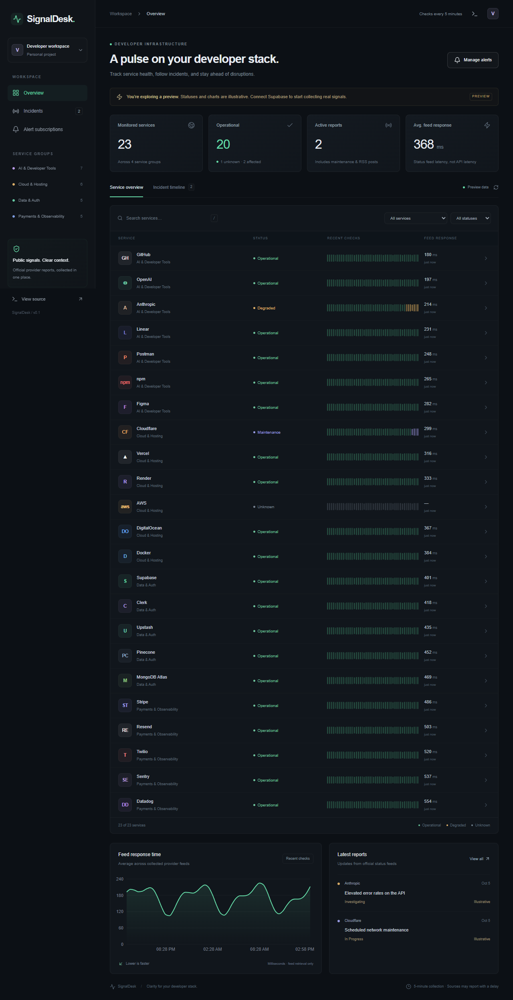

# SignalDesk — Developer Status Tracker

A developer status dashboard for 23 services. Built with Next.js, TypeScript, Tailwind, Recharts, and Supabase; hosted as one free Render web service. GitHub holds the source; an external cron calls the protected probe endpoint every five minutes.

## Start locally

1. Install Node.js 22 or newer, then run `npm ci`.
2. Copy `.env.example` to `.env.local` and fill in the values described in `docs/DEPLOYMENT.md`.
3. Apply `supabase/migrations/001_initial.sql` in the Supabase SQL editor.
4. Run `npm run dev`, then open http://localhost:3000.

Without Supabase credentials the dashboard shows a clearly labelled preview. Preview values are illustrative and never presented as live measurements. Live probing requires database credentials and a cron secret.

## Verification

Run `npm run lint`, `npm run typecheck`, `npm test`, and `npm run build`.

Run `npm run test:e2e` for preview browser checks and `npm run smoke` to inspect public provider feeds without storing data or sending notifications.

## Documentation

- [Requirements](docs/REQUIREMENTS.md)
- [Architecture](docs/ARCHITECTURE.md)
- [Database](docs/DATABASE.md)
- [API contract](docs/API.md)
- [Deployment and free quotas](docs/DEPLOYMENT.md)
- [Security](docs/SECURITY.md)
- [Testing](docs/TESTING.md)
- [Roadmap](docs/ROADMAP.md)
- [Operations](docs/OPERATIONS.md)
- [Provider sources](docs/PROVIDERS.md)
- [Verification record](docs/VERIFICATION.md)

## Preview

The original `project_plan.md` is retained as reference. The documentation above records the corrected implementation decisions. Hosting can operate without your computer, within provider free quotas; uninterrupted service is not guaranteed.
